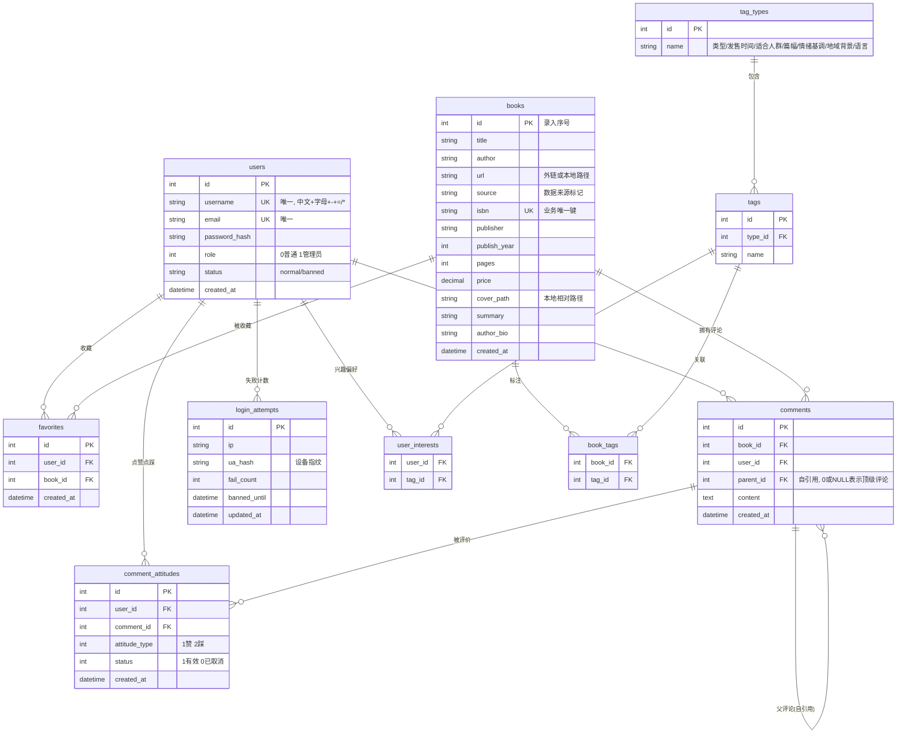

# 图书推荐系统 — 架构与功能汇总

> **文档性质**：项目设计基线（Architecture & Feature Baseline）
> **项目性质**：软件项目开发与实践 2 课程设计
> **上游文档**：《图书推荐系统软件需求规格说明书 v2.docx》（内部版本 v1.1；含 41 条 FR / 11 条 DR / 9 条 UI / 7 条 NFR / 27 条 AC）
> **本文档定位**：汇总需求要点、功能点、目标架构与关键设计决策；标注「✅ 已定 / 🔶 待定」；供后续数据库设计、接口设计、前端开发、测试与答辩使用
> **最后更新**：2026-10-22

---

## 目录

1. [项目概述](#1-项目概述)
2. [需求要点提炼](#2-需求要点提炼)
3. [功能点汇总](#3-功能点汇总)
4. [系统架构](#4-系统架构)
5. [数据模型设计](#5-数据模型设计)
6. [接口清单](#6-接口清单)
7. [关键设计决策汇总](#7-关键设计决策汇总)
8. [待定事项与待办账本](#8-待定事项与待办账本)
9. [风险清单](#9-风险清单)

---

## 1. 项目概述

### 1.1 一句话定位

> 局域网内多终端访问的**图书推荐系统**。核心不是"书库"，而是**基于标签筛选 + 规则加权的图书发现引擎**，外加一套**评论互动 + 信誉治理**机制。

### 1.2 三条不可动摇的约束

| 约束 | 说明 |
|---|---|
| **① 不存正文、不做阅读** | 系统只存图书元数据与外链，内容由外部来源承担 |
| **② 只用实际图书数据，禁用 AI 生成** | 图书由人工整理 JSON 导入，来源可追溯 |
| **③ C/S 架构，客户端为浏览器** | 服务端独立部署，浏览器通过 HTTP 远程访问；当前部署形态为局域网 |

### 1.3 系统边界

| 系统提供 | 系统不提供 |
|---|---|
| 图书标签分类筛选 | 图书阅读功能 |
| 图书列表与详情展示 | 书籍正文存储 / 封面原图内容 |
| 图书外链导航（跳豆瓣/购买页） | 商业化功能 |
| 收藏、评论、回复、点赞、点踩 | 公网部署（当前阶段） |
| 评论排序与置底、级联删除 | 用户删除账号 |
| 猜你喜欢主动推荐 | 管理员修改图书/标签/他人评论内容 |
| 榜单（5 个维度、分页、同值规则） | 管理员删除用户 / 设置其他管理员 |
| 用户注册、登录、退出、封禁 | 邮箱验证码（已按决策砍除） |

### 1.4 角色矩阵

| 能力 | 游客 | 普通用户 | 管理员 |
|---|:---:|:---:|:---:|
| 首页 / 标签筛选 / 图书列表 | ✅ | ✅ | ✅ |
| 图书详情 / 榜单 | ✅ | ✅ | ✅ |
| 收藏 / 评论 / 回复 / 点赞 / 点踩 | ❌ | ✅ | ✅ |
| 猜你喜欢 | ❌ | ✅ | ✅ |
| 个人主页（信息 / 收藏 / 评论 / 回复） | ❌ | ✅ | ✅ |
| 评论管理（删除任意评论） | ❌ | ❌ | ✅ |
| 用户封禁 / 解封 | ❌ | ❌ | ✅ |

> **管理员无独立注册入口**：由开发者在数据库 `users.role = 1` 标记，登录流程与普通用户完全一致。

---

## 2. 需求要点提炼

### 2.1 四大核心算法规则（本项目的技术含量所在）

#### A. 标签筛选（FR-05）

- 标签按 **7 种类型**分组：类型 / 发售时间 / 适合人群 / 篇幅 / 情绪基调 / 地域背景 / 语言
- **同类型单选**：点击同类型另一个标签 → 旧的自动取消，新的选中
- **再点已选标签 = 取消选择**
- **跨类型 = AND**（同时满足所有已选标签）
- 取消某个标签后，若仍有其他类型被选中 → **继续按剩余标签筛选**
- **全部取消** → 回到全量图书 + 默认排序（录入序号，FR-06 / AC-04）

**前端状态模型**：

```
selected = { tagTypeId: tagId }    // 每个类型最多一个

点击标签 T（类型 typeId，值 tagId）：
  if selected[typeId] === tagId:
      delete selected[typeId]        // 再点 = 取消
  else:
      selected[typeId] = tagId       // 同类型替换
  → 重绘高亮 → 重新请求图书列表
```

#### B. 评论热度与置底（FR-24 / FR-25）

| 规则 | 定义 |
|---|---|
| 热度排序 | `点赞数 + 点踩数` 降序（**默认排序**） |
| 时间排序 | `发布时间` 降序 |
| **置底触发** | `点赞数 + 点踩数 ≥ 10` **且** `点赞数 ÷ 点踩数 ≤ 1/4` |
| 除零保护 | `点踩数 = 0` 时**跳过比例判定**（`点赞=0 且 点踩≥10` 仍可触发置底） |
| 置底效果 | 无论当前是热度序还是时间序，**始终排在评论列表最底部** |
| 置底内部 | 多个置底评论之间按**发布时间倒序**（时间晚的靠上） |
| 适用范围 | **回复列表同样适用** |

**实现要点**：置底**不能靠 SQL `ORDER BY` 实现**，必须在应用层分桶：

```
普通桶 normal  → 按当前排序方式（热度 / 时间）
置底桶 pinned  → 按发布时间倒序
最终列表 = normal + pinned
```

#### C. 猜你喜欢（FR-33）

```
兴趣匹配分 = |图书标签 ∩ 用户兴趣标签|           × 3
           + |图书标签 ∩ 用户收藏图书标签(并集)|   × 2
           + |图书标签 ∩ 用户评论图书标签(并集)|   × 1

热度       = 收藏数 + 点赞数
推荐分     = 兴趣匹配分 × 0.7 + 归一化热度 × 0.3
```

- 排除用户已收藏图书
- 按推荐分降序，默认取前 10 本
- **冷启动**：有兴趣标签 → 按兴趣匹配；完全无信息 → 推荐全站热度最高
- **换一批**：支持 `offset` 参数（✅ 决策 3）

> **实现优势**：图书千级规模下，纯 Python 内存计算 < 100ms，**不需要向量库 / ANN / AI 模型**。

#### D. 榜单（FR-34 ~ FR-37）

| 榜单 | 排序口径 | 数值口径标识 |
|---|---|---|
| 热门榜 | 收藏数 + 点赞数 降序 | `收藏 128 · 赞 36` |
| 收藏量榜 | 收藏数 降序 | `收藏 128` |
| 点赞量榜 | 点赞数 降序 | `赞 36` |
| 讨论度榜 | 评论数 降序 | `评论 36` |
| 最差图书榜 | 该书点踩总数 降序 | `点踩 12` |

**通用规则**：

- **不建榜单表**，由图书 / 收藏 / 赞踩 / 评论实时聚合
- 每个榜单最多收录 **100 本**，每页 **10 本**，最多 **10 页**
- **同值 → 按图书 ID 升序**（`ORDER BY metric DESC, book.id ASC`），名次连续无并列
- **名次跨页连续**：第 2 页首行 = 11，第 3 页首行 = 21（名次 = `offset + index + 1`）
- 切换榜单 → 列表与分页器同步刷新 → **回到该榜第 1 页**
- 榜单行**只展示与跳转**，不放收藏/评论按钮

### 2.2 非功能要点

| 编号 | 要点 | 备注 |
|---|---|---|
| NFR-01 | 局域网部署，笔记本作服务器，客户端经移动热点访问 | ✅ 决策 6，已从"本地单机"修订 |
| NFR-02 | 前端 HTML + 后端 Python + 数据库 MySQL | 硬约束，不可违背 |
| NFR-03 | 密码非明文存储（scrypt/PBKDF2）、登录错误统一提示、邮箱遮挡 | 保留 |
| NFR-04 | 页面结构清晰、菜单固定、危险操作有确认提示 | 保留 |
| NFR-05 | 列表 / 筛选 / 评论加载无明显等待；操作及时反馈 | 局域网 <1ms，易满足 |
| NFR-06 | 需求 / 数据库 / 接口 / 页面可追踪；标签便于增删；图书支持批量导入 | ✅ 导入功能是 NFR-06 的落地 |
| NFR-07 | 提供《用户协议》与《隐私政策》；注册必须勾选 | 附录 A/B 直接落地为静态页 |

---

## 3. 功能点汇总

### 3.1 总览

| 模块 | 页面 | 功能条目 |
|---|---|---|
| M1 全局框架 | 全部 | 8 |
| M2 首页 | `/` | 11 |
| M3 榜单页 | `/ranking` | 7 |
| M4 图书详情页 | `/book/<id>` | 12 |
| M5 登录页 | `/login` | 4 |
| M6 注册页 | `/register` | 9 |
| M7 个人主页 | `/profile` | 9 |
| M8 管理页 | `/admin` | 7 |
| **合计** | 7 页 | **67** |

### 3.2 M1 全局框架

| 编号 | 功能 | 对应需求 |
|---|---|---|
| F-01 | 顶部菜单栏固定置顶，页面跳转后保持存在 | FR-01 / UI-01 |
| F-02 | 左侧标题「图书推荐系统」可点击回首页 | FR-02 |
| F-03 | 右侧菜单按三态切换：游客 / 普通用户 / 管理员 | FR-01 |
| F-04 | 「管理」入口仅管理员渲染（源码中不出现，非 CSS 隐藏） | FR-38 |
| F-05 | 退出登录 → 确认 → 跳回首页，菜单恢复游客态 | FR-31 / AC-26 |
| F-06 | 统一 Toast 反馈（右上角，3s 自动消失） | NFR-04 |
| F-07 | 统一 Modal 确认框（删除 / 封禁等危险操作） | FR-26 / FR-39 / FR-40 / AC-25 |
| F-08 | 统一未登录拦截：提示「请先登录」+ 登录链接（不直接跳转） | FR-03 |

### 3.3 M2 首页 `/`

| 编号 | 功能 | 对应需求 |
|---|---|---|
| F-09 | 猜你喜欢区块，**仅登录用户渲染**，位于标签筛选区上方 | FR-32 / UI-02 |
| F-10 | 猜你喜欢卡片点击进详情页；支持「换一批」（offset + total） | FR-32 / FR-33 ✅ 决策 3 |
| F-11 | 标签筛选区：7 个类型分组，每行类型名 + 该类型全部标签 | FR-05 / 附录 C |
| F-12 | 标签点击高亮；同类型单选（选新的旧的自动取消） | FR-05 / AC-03 |
| F-13 | 再点已选标签 = 取消；跨类型同时生效（AND）；全部取消回全量 | FR-05 / AC-03 |
| F-14 | 选中状态同步到 URL query（可刷新 / 可分享 / 可后退） | ✅ 设计决策 |
| F-15 | 图书列表：封面 + 书名 + 作者 + 部分标签 | FR-06 |
| F-16 | 无封面显示「暂无预览图」 | FR-06 / AC-24 |
| F-17 | 封面 / 书名点击进详情页 | FR-06 / FR-17 |
| F-18 | 收藏按钮（登录可见）：点击即时切换收藏态，不跳转 | FR-04 / FR-18 |
| F-19 | **分页**：每页 24 本，底部统一分页控件 | ✅ 决策 1 |

> **附加设计**：标签筛选区顶部增加「已选标签 chips」行，可单个移除 —— 比"再点一次标签"更顺手。

### 3.4 M3 榜单页 `/ranking`

| 编号 | 功能 | 对应需求 |
|---|---|---|
| F-20 | 五个榜单 Tab（热门 / 收藏量 / 点赞量 / 讨论度 / 最差图书），选中高亮，默认热门榜 | FR-34 / AC-15 |
| F-21 | 切换 Tab → 列表与分页器同步刷新 → 回到该榜第 1 页 | FR-34 / AC-15 |
| F-22 | 榜单头部显示当前榜单名 + **排序口径说明** | FR-34 / UI-07 |
| F-23 | 榜单行版式：排名区 \| 预览图 \| 信息区，**整行可点**进详情页，悬停高亮 | FR-37 / AC-19 / AC-20 |
| F-24 | 信息区显示书名 / 作者·出版社·出版年 / **带口径标识的数值** | FR-37 / UI-08 |
| F-25 | 分页控件：上一页 + 页码 + 下一页 + 「第 X 页 / 共 Y 页」，首末页按钮禁用 | FR-36 / AC-16 / AC-21 |
| F-26 | 榜单行内**不出现**收藏 / 评论等操作按钮 | FR-37 / UI-08 |

### 3.5 M4 图书详情页 `/book/<id>`

| 编号 | 功能 | 对应需求 |
|---|---|---|
| F-27 | 基本信息区：封面 + 书名 / 作者 / 出版社 / 出版年 / ISBN / 页数 / 定价 | FR-18 / AC-09 |
| F-28 | 标签按 7 类型分组展示；收藏按钮置于基本信息区 | FR-18 |
| F-29 | **外部资源入口按钮**（按 `url` 类型渲染：外链 / 豆瓣搜索降级） | ✅ 决策 8 |
| F-30 | 图书介绍区：内容简介 + 作者简介（缺失显示「暂无简介」/「—」） | FR-19 |
| F-31 | 评论区排序切换：按热度 / 按时间，默认按热度 | FR-24 / AC-10 |
| F-32 | 评论项显示：用户名 + 内容 + 时间 + 点赞数 + 点踩数 + [点赞][点踩][回复] | FR-20 |
| F-33 | 发表评论后**即时插入列表**，无需手动刷新 | FR-20 |
| F-34 | 回复缩进挂在父评论下；回复的回复再缩进；回复列表只按热度 | FR-22 |
| F-35 | 点赞 / 点踩显示数字，已操作态高亮 | FR-23 |
| F-36 | 赞踩**不可直接切换**（需先取消），冲突时提示 | FR-23 / AC-12 |
| F-37 | **置底评论始终排在最后**（热度序与时间序都沉底），沉底区内按时间倒序 | FR-25 / AC-11 |
| F-38 | 游客看到「请登录后发表评论」+ 登录链接，赞踩按钮禁用 | FR-20 |

### 3.6 M5 登录页 `/login`

| 编号 | 功能 | 对应需求 |
|---|---|---|
| F-39 | 账号框（用户名**或**邮箱）+ 密码框 + 显示开关 + 登录按钮（在密码框下方） | FR-14 / UI-03 |
| F-40 | 密码框初始掩码，右侧小眼睛开关默认关闭，hover 提示「开启后，显示密码」 | FR-14 |
| F-41 | 错误**统一提示**「账号不存在或密码错误」，不区分原因 | FR-15 / AC-07 |
| F-42 | 封禁 / 自动封禁分别提示；成功后跳首页，菜单切登录态 | FR-16 / FR-15 / AC-08 |

### 3.7 M6 注册页 `/register`

> ✅ 决策 2：**仅保留图形验证码**，邮箱验证码整条链路移除，字段从 6 个降为 5 个。

| 编号 | 功能 | 对应需求 |
|---|---|---|
| F-43 | 五个字段：用户名、邮箱、密码、图形验证码、协议开关 | FR-07 |
| F-44 | 协议文字含两份文件链接，**新标签页打开**，不离开注册页 | FR-07 / AC-27 |
| F-45 | 未勾选协议 → 注册按钮**灰色不可点击**；勾选后可点击 | FR-07 / AC-05 |
| F-46 | 图形验证码图片**点击可换一张** | FR-11 |
| F-47 | 前端即时校验：用户名唯一性 + 字符集、邮箱格式 + 唯一性、密码规则 | FR-08 ~ FR-10 |
| F-48 | 提交按 **用户名 → 邮箱 → 密码 → 图形码 → 协议勾选** 顺序校验 | FR-13 / AC-06 |
| F-49 | 注册成功提示后，**所有输入框与开关重置为初始状态**，不自动登录 | FR-13 |
| F-50 | 邮箱域名限制**已放开**（任意合法邮箱格式） | ✅ 决策 4 |
| F-51 | 已移除：邮箱验证码输入栏、获取验证码按钮、发送冷却倒计时 | ✅ 决策 2 |

### 3.8 M7 个人主页 `/profile`

| 编号 | 功能 | 对应需求 |
|---|---|---|
| F-52 | 基本信息：用户名 + 邮箱（`a***@qq.com` 遮挡）+ 注册时间 | FR-27 |
| F-53 | 兴趣偏好展示与编辑（从 7 类标签中勾选，直接喂给猜你喜欢） | FR-27 / FR-33 |
| F-54 | 我的收藏：封面 / 书名 / 作者 / 标签，点击进详情页 | FR-28 |
| F-55 | 每条收藏带「删除收藏」→ 确认框 → 从列表移除 | FR-28 / FR-26 |
| F-56 | 我的评论：内容 + 时间 + 赞踩数 + 所属图书 | FR-29 |
| F-57 | 每条评论带「删除评论」→ 确认框 → **级联删除其下所有回复** | FR-26 / FR-29 / AC-13 |
| F-58 | 我的回复：内容 + 时间 + 赞踩数 + 所回复的评论 / 图书信息 | FR-30 |
| F-59 | 每条回复带「删除回复」→ 确认框 → 级联删除下级回复 | FR-26 / FR-30 |
| F-60 | 本页可退出登录；三个列表**均分页**（收藏 12 / 评论 10 / 回复 10 每页） | ✅ 决策 1 |

### 3.9 M8 管理页 `/admin`

| 编号 | 功能 | 对应需求 |
|---|---|---|
| F-61 | 两个 Tab：评论管理 / 用户管理 | FR-39 / FR-40 / UI-09 |
| F-62 | 评论列表时间倒序，显示评论者 / 所属图书 / 内容 / 时间 / 赞踩数，**不参与置底排序** | FR-39 |
| F-63 | 管理员可删除任意评论（级联删回复）/ 删除任意回复（不影响上级评论） | FR-39 |
| F-64 | 用户列表：用户名 + 邮箱遮挡 + 注册时间 + 角色 + 状态（正常 / 封禁） | FR-40 |
| F-65 | 可封禁 / 解封普通用户；**不能封禁管理员、不能封禁自己**（按钮禁用） | FR-40 / AC-22 |
| F-66 | 用户管理区**无删除用户入口** | FR-40 |
| F-67 | 删除 / 封禁 / 解封均有确认提示 | AC-25 |

### 3.10 M9 图书数据导入（✅ 决策 8 新增的正式功能）

| 编号 | 功能 | 状态 |
|---|---|---|
| F-68 | 支持 JSON 文件导入图书数据，按唯一键 upsert（ISBN 优先，缺省用 书名+作者） | 🔶 待写入 SRS |
| F-69 | 导入前校验：字段结构、必填项、URL 格式、**标签必须命中附录 C 清单** | 🔶 |
| F-70 | 封面处理：外链封面**下载到本地** `static/covers/`，失败则使用「暂无预览图」 | 🔶 |
| F-71 | 输出**导入报告**：新增 / 更新 / 跳过数量 + 逐条失败原因 | 🔶 |
| F-72 | 幂等：重复导入执行更新而非插入，可边整理边导入 | 🔶 |

---

## 4. 系统架构

### 4.1 系统上下文

```
   ┌──────────────┐   ┌──────────────┐   ┌──────────────┐
   │  游客浏览器   │   │ 普通用户浏览器 │   │  管理员浏览器 │
   └───────┬──────┘   └───────┬──────┘   └───────┬──────┘
           └──────────────────┼──────────────────┘
                              │  HTTP / 同源 /api/*
                              ▼
                  ┌───────────────────────────┐
                  │   图书推荐系统（服务端）     │
                  │   独立部署 · 长期在线       │
                  └───────────────────────────┘
```

> **C/S 判据**：服务端与客户端完全分离、通信走网络协议、服务端不持有客户端位置状态、与客户端物理部署网段无关。
> 同一局域网访问与公网访问在逻辑拓扑上等价，仅可达范围不同。

### 4.2 逻辑分层架构

```
┌──────────────────────────────────────────────────────────────────────┐
│  表现层  浏览器                                                       │
│  ┌────────────────────────────────────────────────────────────────┐  │
│  │  Jinja2 模板（7 个页面，服务端出 HTML 骨架）                     │  │
│  │  /  /ranking  /book/<id>  /login  /register  /profile  /admin   │  │
│  ├────────────────────────────────────────────────────────────────┤  │
│  │  原生 JS 模块（fetch 同源 /api/*，无构建链）                     │  │
│  │  api.js  session.js  home.js  reco.js                           │  │
│  │  ranking.js  comment.js  profile.js  admin.js                   │  │
│  └────────────────────────────────────────────────────────────────┘  │
└───────────────────────────────┬──────────────────────────────────────┘
                                │  Session Cookie (HttpOnly, SameSite=Lax)
┌───────────────────────────────▼──────────────────────────────────────┐
│  应用层  Flask 3 + Werkzeug                                          │
│  ┌────────────────────────────────────────────────────────────────┐  │
│  │  页面路由 Blueprints                                             │  │
│  │  API 路由 Blueprints   /api/auth  /api/books  /api/tags         │  │
│  │                       /api/comments  /api/favorites             │  │
│  │                       /api/ranking  /api/recommend  /api/admin  │  │
│  ├────────────────────────────────────────────────────────────────┤  │
│  │  业务层 Service                                                  │  │
│  │  AuthService      登录校验 / 失败计数 / 封禁判定（IP+UA 组合键） │  │
│  │  BookService      图书查询 / 标签筛选 / 详情                     │  │
│  │  TagService       标签树                                          │  │
│  │  CommentService   层级评论 / 排序 / **置底分桶** / 级联删除        │  │
│  │  FavoriteService  收藏增删查                                        │  │
│  │  RankService      5 榜聚合 / 同值排序 / 分页 / 名次生成          │  │
│  │  RecommendService 加权推荐分 / 冷启动 / offset 换一批             │  │
│  │  AdminService     评论管理 / 用户封禁解封 / 权限边界              │  │
│  │  CaptchaService   图形验证码生成与校验（session 暂存）           │  │
│  │  ImportService    JSON 解析 / 校验 / 封面下载 / upsert / 报告     │  │
│  ├────────────────────────────────────────────────────────────────┤  │
│  │  横切能力                                                       │  │
│  │  登录态管理 · 角色鉴权装饰器 · 统一响应体 · 参数校验 · 错误码    │  │
│  └────────────────────────────────────────────────────────────────┘  │
└───────────────────────────────┬──────────────────────────────────────┘
                                │  SQLAlchemy 2.0 (ORM + Core SQL)
┌───────────────────────────────▼──────────────────────────────────────┐
│  数据层                                                               │
│  ┌────────────────────────────┐  ┌──────────────────────────────┐  │
│  │  MySQL 8 (127.0.0.1:3306)  │  │  本地文件                    │  │
│  │  9 张业务表                │  │  static/covers/  封面图      │  │
│  │  仅本机可访问，不暴露      │  │  static/img/    暂无预览图   │  │
│  │                            │  │  data/import/    books.json  │  │
│  └────────────────────────────┘  └──────────────────────────────┘  │
└──────────────────────────────────────────────────────────────────────┘
```

### 4.3 部署拓扑（✅ 决策 6：笔记本开移动热点）

```
┌──────────────────────┐            WiFi 热点             ┌──────────────────────┐
│   同学的手机           │◀──────── 192.168.137.0/24 ────▶│   你的笔记本 (Server) │
│   浏览器               │         (Windows 移动热点)        │   192.168.137.1       │
│                      │                                   │                      │
│  http://192.168.137.1 │◀──────────────────────────────────│   Flask  0.0.0.0:8080│
│        :8080         │        HTTP（局域网，明文可接受）    │   MySQL  127.0.0.1    │
│                      │                                   │   static/covers/      │
│  扫二维码即可打开 ────┼─── 启动脚本自动打印 URL + 二维码      │   books.json 导入     │
└──────────────────────┘                                   └──────────────────────┘
```

**为什么选 Windows 移动热点**：

| 优势 | 说明 |
|---|---|
| IP 固定 | 服务端恒为 `192.168.137.1`，同学记一次即可长期使用 |
| 网段固定 | `192.168.137.0/24`，不随路由器变化 |
| 不依赖路由器 | 无需校园网 / 宿舍网权限 |
| 地址可预期 | 便于写进文档、便于口述 |

> ⚠️ 需在「设置 → 网络和 Internet → 移动热点」中选择**有线网卡**共享，避免 WiFi 自环导致 IP 冲突。

### 4.4 技术栈选型

| 层 | 选型 | 理由 |
|---|---|---|
| 后端框架 | **Flask 3 + Jinja2** | 契合 NFR-02「HTML 前端 + Python 后端」，无需 npm 构建链 |
| ORM | **SQLAlchemy 2.0** | ORM 建模型；复杂聚合（榜单、置底统计）走 Core SQL |
| DB 驱动 | **PyMySQL** | 纯 Python，免编译 |
| 密码哈希 | **Werkzeug `generate_password_hash`**（scrypt / PBKDF2） | 自带盐值管理，免装 bcrypt |
| 图形验证码 | **Pillow** | 生成图片 + `StringIO` 返回 |
| 会话 | **Flask 内置 Cookie Session** | 局域网 HTTP 下不加 `Secure`；`HttpOnly` + `SameSite=Lax` |
| 前端 | **原生 HTML / CSS / JS + fetch** | 零构建链，交互模块按需划分 |
| 数据库 | **MySQL 8** | NFR-02 硬约束 |
| 部署 | **Flask 内置服务器即可**（`host='0.0.0.0'`） | 局域网规模足够；暂不引入 Nginx / Docker |

> **留出的升级口子**（不做但记录）：公网阶段加 Nginx（静态资源 + gzip + TLS）、多 worker 需 `flask-session` 共享存储、隧道需真实 IP 提取器。

### 4.5 前端模块划分与 DOM 归属

> **原则：每个 JS 模块只拥有一个 DOM 区域**，避免逻辑纠缠。

| 模块 | 拥有的 DOM 区域 | 职责 |
|---|---|---|
| `api.js` | 无 | fetch 封装、统一错误 → Toast / Modal |
| `session.js` | 无 | 当前用户、角色、收藏 ID 集合（全局单例） |
| `home.js` | 标签筛选区 + 图书列表区 | 筛选状态机、列表加载与分页 |
| `reco.js` | 猜你喜欢区 | 加载、换一批（offset） |
| `ranking.js` | 榜单 Tab + 榜单列表 + 分页 | 榜单切换、分页（URL 驱动） |
| `comment.js` | 评论区 | 排序切换、发表、回复、赞踩、**置底分桶渲染** |
| `profile.js` | 个人主页 | 兴趣编辑、各列表删除与分页 |
| `admin.js` | 管理页 | 封禁 / 解封 / 删除 |

### 4.6 前端状态归属

| 状态 | 存放位置 | 理由 |
|---|---|---|
| 标签筛选选中项 | **URL query** | 可刷新 / 可分享 / 后退可用；Jinja 读 query 渲染初始高亮 |
| 榜单 Tab + 页码 | **URL query** | 同上；天然满足"翻页只刷新列表区" |
| 评论区排序 + 页码 | 组件内存 | 页内交互，无需分享 |
| 登录态 / 角色 | Jinja 注入全局变量 | 避免每请求查库；**后端每个 API 独立再校验一次** |
| 收藏 ID 集合 | 内存 `Set` | 列表卡片收藏态渲染，避免 N 次请求 |
| 表单输入 | 页面内存 | 不跨页保留 |

> **双写原则**：URL 中的筛选条件是**输入**，真正的过滤在服务端 SQL。前端只负责「状态机 + 发请求 + 重绘高亮」，**不做任何过滤逻辑** —— 保证 AC-03 的行为只有一个真源。

### 4.7 关键请求时序：评论列表的置底分桶

```
浏览器                          Flask                         MySQL
  │                              │                              │
  │ GET /api/books/12/comments   │                              │
  │ ?sort=hot&page=1             │                              │
  ├─────────────────────────────▶│                              │
  │                              │ SELECT 基础评论 + 赞踩聚合     │
  │                              ├─────────────────────────────▶│
  │                              │◀─────────────────────────────┤
  │                              │                              │
  │                              │ ① 取普通桶（热度/时间排序）    │
  │                              │ ② 逐条判定置底条件            │
  │                              │    赞+踩 ≥ 10 且 赞/踩 ≤ 1/4   │
  │                              │ ③ 置底桶按发布时间倒序          │
  │                              │ ④ normal + pinned 拼接         │
  │◀─────────────────────────────┤                              │
  │ { normal: [...], pinned: [...] }                            │
  │ 渲染：normal → pinned（视觉分隔条 + 规则说明）                 │
```

> **前端只负责拼接与展示，置底判定完全在服务端** —— 避免规则在前后端重复实现导致不一致。

### 4.8 目录结构建议

```
图书推荐系统/
├─ app/
│  ├─ __init__.py            # Flask app 工厂、扩展初始化
│  ├─ config.py              # 配置（密钥、数据库 URI、封禁阈值）
│  ├─ models/                # SQLAlchemy 模型
│  │  ├─ user.py  book.py  tag.py  comment.py
│  │  ├─ favorite.py  attitude.py  login_attempt.py
│  ├─ services/              # 业务层
│  │  ├─ auth_service.py  book_service.py  comment_service.py
│  │  ├─ rank_service.py  recommend_service.py  import_service.py
│  ├─ routes/
│  │  ├─ pages.py            # 7 个页面路由
│  │  ├─ api_auth.py  api_books.py  api_comments.py
│  │  ├─ api_ranking.py  api_recommend.py  api_admin.py
│  ├─ templates/             # Jinja2
│  │  ├─ base.html  index.html  ranking.html  book_detail.html
│  │  ├─ login.html  register.html  profile.html  admin.html
│  │  └─ legal/  user_agreement.html  privacy_policy.html
│  └─ static/
│     ├─ css/
│     ├─ js/  api.js  session.js  home.js  reco.js
│     │        ranking.js  comment.js  profile.js  admin.js
│     ├─ covers/             # 导入时下载的封面
│     └─ img/  no_cover.png   # 暂无预览图
├─ data/
│  └─ import/  books.json    # 图书源数据（人工整理）
├─ scripts/
│  ├─ import_books.py        # JSON 导入脚本
│  ├─ seed_data.py           # 种子数据（用户 / 收藏 / 评论 / 赞踩）
│  └─ start_server.py        # 启动脚本：打印本机 IP + 二维码
├─ requirements.txt
└─ run.py
```

---

## 5. 数据模型设计

### 5.1 ER 图



### 5.2 关键约束与索引

| 表 | 约束 / 索引 | 用途 |
|---|---|---|
| `users` | `UNIQUE(username)`、`UNIQUE(email)`、`UNIQUE` role+status 索引 | FR-08 / FR-09 / 管理端列表 |
| `books` | `UNIQUE(isbn)`（可为 NULL）、`INDEX(publish_year)` | 导入幂等 upsert |
| `tags` | `UNIQUE(type_id, name)` | 标签查找 |
| `book_tags` | `PRIMARY KEY(book_id, tag_id)` + `INDEX(tag_id)` | **多标签 AND 筛选性能** |
| `favorites` | `UNIQUE(user_id, book_id)` + `INDEX(book_id)` | 收藏幂等 + 榜单收藏量统计 |
| `comments` | `INDEX(book_id, parent_id, created_at)` | 评论列表 / 榜单评论数统计 |
| `comment_attitudes` | `UNIQUE(user_id, comment_id)` + `INDEX(comment_id)` | **赞踩唯一性（决策 5）** + 置底统计 |
| `login_attempts` | `UNIQUE(ip, ua_hash)` | **封禁组合键（决策 2）** |
| `user_interests` | `PRIMARY KEY(user_id, tag_id)` | 兴趣偏好 |

---

## 6. 接口清单

> 路径与返回格式在技术设计阶段细化；此处为概要级清单。

### 6.1 页面路由

| 路由 | 说明 | 访问权限 |
|---|---|---|
| `GET /` | 首页：猜你喜欢 + 标签筛选 + 图书列表 | 公开 |
| `GET /ranking` | 榜单页（`?type=&page=`） | 公开 |
| `GET /book/<id>` | 图书详情页 | 公开 |
| `GET /login` | 登录页 | 仅游客 |
| `GET /register` | 注册页 | 仅游客 |
| `GET /profile` | 个人主页 | 需登录 |
| `GET /admin` | 管理面板 | 需管理员 |

### 6.2 API

| 方法 | 路径 | 支撑功能 |
|---|---|---|
| `GET` | `/api/session` | F-03 / F-04 登录态与角色 |
| `GET` | `/api/tags` | F-11 标签树 |
| `GET` | `/api/books?tags=&page=&size=` | F-13 ~ F-19 筛选与分页 |
| `GET` | `/api/books/<id>` | F-27 ~ F-30 详情 |
| `GET` | `/api/me/favorite-ids` | F-18 收藏态渲染 |
| `POST` / `DELETE` | `/api/favorites` | F-18 / F-55 |
| `GET` | `/api/ranking?type=&page=` | F-20 ~ F-25 |
| `GET` | `/api/recommend?offset=` | F-09 / F-10 猜你喜欢 + 换一批 |
| `GET` | `/api/books/<id>/comments?sort=&page=` | F-31 ~ F-37（返回 `normal` + `pinned` 两桶） |
| `POST` | `/api/books/<id>/comments` | F-33 发表 / F-34 回复 |
| `DELETE` | `/api/comments/<id>` | F-57 / F-59 / F-63 级联删除 |
| `POST` | `/api/comments/<id>/attitude` | F-35 / F-36 赞踩与取消 |
| `GET` | `/api/captcha` | F-46 图形验证码 |
| `POST` | `/api/auth/login` | F-39 ~ F-42 |
| `POST` | `/api/auth/register` | F-43 ~ F-49 |
| `POST` | `/api/auth/logout` | F-05 / F-60 |
| `GET` / `PUT` | `/api/me/profile` | F-52 / F-53 |
| `GET` | `/api/me/favorites\|comments\|replies` | F-54 / F-56 / F-58（含分页） |
| `GET` | `/api/admin/comments` | F-62 |
| `GET` | `/api/admin/users` | F-64 |
| `POST` | `/api/admin/users/<id>/ban\|unban` | F-65 |
| `POST` | `/api/admin/import` | F-68 ~ F-71 图书导入 |

---

## 7. 关键设计决策汇总

> 本节是历次讨论沉淀的决策台账，每条含 **决策内容 / 理由 / 影响范围**。

### D-01 ✅ 所有分页要求全部实现

| 项 | 内容 |
|---|---|
| 决策 | 首页图书列表（24/页）、评论区（20/页）、个人主页收藏（12/页）与评论/回复（10/页）、榜单（10/页，需求已有）全部实现 |
| 理由 | 用户明确要求"所有分页要求都满足" |
| 影响 | 新增通用分页控件组件（4 处复用）；需新增 DR / UI 条目 |

### D-02 ✅ 仅保留图形验证码，砍除邮箱验证码链路

| 项 | 内容 |
|---|---|
| 决策 | 删除邮箱验证码输入栏、获取验证码按钮、发送冷却倒计时、SMTP 依赖；注册流程简化为 **用户名 → 邮箱 → 密码 → 图形码 → 协议** |
| 理由 | 邮箱验证码是系统**唯一的对外依赖**；砍除后系统完全自包含，部署与演示零外部依赖，NFR-01 大幅简化 |
| 影响 | FR-12（删）、FR-13 校验顺序、DR-10、NFR-01 邮件依赖、2.6 假设、AC-06 全部需修订 |

### D-03 ✅ 猜你喜欢支持「换一批」

| 项 | 内容 |
|---|---|
| 决策 | 接口增加 `offset` 参数；前端保留 offset 计数并显示「换一批」按钮；总数不足时按钮禁用并提示「暂无更多推荐」 |
| 理由 | 提升体验；实现成本低（后端一个参数） |
| 影响 | FR-32 / FR-33 增补 |

### D-04 ✅ 放开邮箱域名限制

| 项 | 内容 |
|---|---|
| 决策 | FR-09 由"仅支持 QQ 邮箱和网易邮箱"改为"任意合法邮箱格式"，但**保留唯一性约束** |
| 理由 | 邮箱验证码砍除后，域名白名单无实际校验价值，仅造成用户挫败 |
| 影响 | FR-09 修订；邮箱唯一性必须保留（邮箱是登录标识符之一） |

### D-05 ✅ 允许自赞自踩；每个用户对每个帖子点赞次数仅能一次

| 项 | 内容 |
|---|---|
| 决策 | ① 允许对自己发表的评论点赞 / 点踩；② 同一用户对同一评论**取消后不可再次操作**（保留 `status=0` 墓碑记录） |
| 理由 | ① FR-23 字面只写"他人的评论"，严格执行会导致管理员 / 作者无法操作自己的内容；② 点赞量是榜单排序依据，若允许反复取消-重赞，排名可被刷 |
| 实现 | `comment_attitudes` 唯一键 `(user_id, comment_id)` + `status` 字段；计数只统计 `status=1` |
| 影响 | FR-23、DR-08、AC-12 修订；点踩同规则（避免"赞→取消→踩→取消→赞"套利） |

### D-06 ✅ 部署形态：笔记本开移动热点，局域网模式

| 项 | 内容 |
|---|---|
| 决策 | 服务端 = 笔记本，`192.168.137.1:8080`；客户端 = 浏览器；**当前只做局域网模式，不做内网穿透** |
| 理由 | 零成本、零外部依赖、IP 固定稳定、延迟 <1ms；穿透方案留待需要跨网演示时再启用 |
| 连带 | ① 必须监听 `0.0.0.0`；② 必须配置 Windows 防火墙（专用网络）放行 8080；③ 启动脚本自动打印本机 IP + **生成二维码**；④ 前端 API 一律用**相对路径**，换部署形态零改动 |

### D-07 ✅ 自动封禁键 = IP + 设备指纹（组合键）

| 项 | 内容 |
|---|---|
| 决策 | 封禁记录键为 `(ip, ua_hash)`；同一设备指纹失败 10 次 → 封禁该设备 |
| 理由 | **局域网内所有设备共用同一出口 IP**，若按纯 IP 封禁，同学 A 手滑输错 10 次密码将导致全场被封 24 小时，演示当场翻车 |
| 附带修正 | FR-16 原文"IP **或** 设备信息"在同网关多设备场景下不成立，改为组合键是更严谨的表述 |
| 影响 | FR-16、DR-09 修订；`login_attempts` 表结构随之调整 |

### D-08 ✅ 图书数据模型：元数据 + 跳转 URL，JSON 导入

| 项 | 内容 |
|---|---|
| 决策 | 每条图书记录 = 关键元数据 + 一个 `url` 跳转目标；图书通过 **JSON 手工整理导入**；封面导入时**下载到本地** |
| 理由 | ① 直接解除"图书数据来源"这一最高风险项（不再依赖爬虫稳定性或公开 API 中文覆盖）；② 人工标注的标签质量远高于爬取；③ 系统保持"只存元数据不存正文"的原始约束 |
| 影响 | DR-02 新增 `url` / `source` / `cover_path`；新增 **FR-43 ~ F-72 导入功能**；附录 C 由"系统内置标签"升格为"**导入数据的校验规范**" |

### D-09 ✅ 图书点击行为：卡片 → 本地详情页，外链作为详情页按钮

| 项 | 内容 |
|---|---|
| 决策 | 列表 / 榜单卡片点击 → 本地 `/book/<id>`；详情页提供"外部资源入口"按钮，按 `url` 渲染（外链 → 新标签打开；空或本地路径 → 降级为豆瓣搜索该书名） |
| 理由 | 评论区与收藏是需要停留的地方，外链只是终点；点书名就跳走会把最有黏性的功能藏起来；且保持 AC-20"榜单行跳转到图书详情页"不变 |
| 影响 | FR-18 增补外部入口；FR-37 / AC-20 无需改写 |

### D-10 ✅ 评论区分页 × 置底：沉底区独立不分页

| 项 | 内容 |
|---|---|
| 决策 | 普通评论正常分页；**置底评论独立一栏置于最底部**，一次性返回（上限 20 条，超出折叠「查看更多」），并加视觉分隔条 + 规则说明文字 |
| 理由 | 符合直觉（"争议大的都在最下面"）；置底本身稀有（需赞+踩≥10 且比例≤1/4）；实现最简且避免"翻页后沉底又出现"的割裂感 |
| 影响 | FR-25 / FR-20 增补；UI-05 增补沉底区样式；AC-11 增补"沉底区独立展示" |

### D-11 ✅ 标签使用中文名，不用 ID

| 项 | 内容 |
|---|---|
| 决策 | JSON 中标签写作 `"类型:科幻"`，导入时按名称查 `tag_types` / `tags` |
| 理由 | 人工可读可手写；与数据库 ID 解耦（换机器不失效）；diff 友好；**导入脚本天然成为标签体系的校验闸门** |

### D-12 ✅ 图书导入成为系统的正式功能

| 项 | 内容 |
|---|---|
| 决策 | 导入不再是"技术设计阶段的准备工作"，而是系统功能；新增 FR 条目与导入报告 UI |
| 理由 | 需求文档要求"图书数据应支持批量导入"（NFR-06），且导入结果报告是数据质量的可见证据 |
| 影响 | 新增 FR-43 / UI-10；文档需正式记录 |

---

## 8. 待定事项与待办账本

### 8.1 待定决策（🔶 建议已给出，待确认）

| # | 问题 | 建议 | 状态 |
|---|---|---|---|
| 1 | 图书量目标 | **200~300 本**。低于 100 本时五个榜单的排序区分度会很差（收藏/点赞/评论数集中在 0~3，AC-17 的"同值按 ID 升序"反而成为主力规则） | 🔶 |
| 2 | 导入脚本是否内置封面下载 + 压缩 | **做**。一次性动作，同时解决防盗链、带宽、加载速度三个问题 | 🔶 |
| 3 | 讨论度榜的"评论数"是否含回复 | **不含**，只统计一级评论 | 🔶 |
| 4 | 最差图书榜的"点踩数"口径 | 该书**所有评论（含回复）的点踩数之和** | 🔶 |
| 5 | 图形验证码有效期 | 2 分钟，一次性，存 session | 🔶 |
| 6 | 图书简介缺失时的呈现 | 显示「暂无简介」；其他可选字段（出版社/年份/ISBN/页数/定价）显示「—」 | 🔶 |
| 7 | 是否引入种子数据 | **是**。少量演示用户 + 分布式的收藏/评论/赞踩记录，使榜单数值有梯次 | 🔶 |

### 8.2 文档待办账本（需求文档尚未修订，按讨论深入后再统一落纸）

| # | 涉及条目 | 修订类型 | 关联决策 |
|---|---|---|---|
| 1 | 2.2 运行环境与网络方式 | 重写为局域网部署（笔记本 + 移动热点） | D-06 |
| 2 | 2.4 功能边界 | 删除"公网部署"相关表述 | D-06 |
| 3 | 2.5 设计与实施约束 | 图书获取方式确定为「JSON 人工整理导入」 | D-08 |
| 4 | 2.6 假设与依赖 | 更新部署与数据前提 | D-06 / D-08 |
| 5 | 附录 C 标签清单 | 升格为「导入数据的校验规范」 | D-08 / D-11 |
| 6 | 附录 D 需求追溯矩阵 | 随新条目同步扩充 | 全部 |
| 7 | FR-05 / FR-06 / FR-33 | 增补分页、换一批、URL 同步 | D-01 / D-03 |
| 8 | FR-09 | 邮箱域名限制放开，保留唯一性 | D-04 |
| 9 | FR-12 | **删除**（邮箱验证码） | D-02 |
| 10 | FR-13 | 注册校验顺序调整 | D-02 |
| 11 | FR-16 | 封禁键改为 IP + 设备指纹组合 | D-07 |
| 12 | FR-18 | 增补外部资源入口按钮 | D-09 |
| 13 | FR-20 / FR-25 / FR-36 | 增补评论区沉底区与分页规则 | D-10 / D-01 |
| 14 | FR-23 | 允许自赞；取消后不可再操作 | D-05 |
| 15 | FR-33 | 增补 offset 换一批与冷启动细则 | D-03 |
| 16 | **新增 FR-43** | 图书数据导入功能 | D-12 |
| 17 | **新增 UI-10** | 导入结果报告 | D-12 |
| 18 | DR-02 | 图书实体新增 `url` / `source` / `cover_path` | D-08 |
| 19 | DR-08 | 赞踩唯一约束 + `status` 墓碑 | D-05 |
| 20 | DR-09 | 封禁记录键 = `ip` + `ua_hash` | D-07 |
| 21 | DR-10 | 验证码数据简化（仅图形验证码） | D-02 |
| 22 | NFR-01 | 重写为局域网部署 | D-06 |
| 23 | NFR-03 | 增补局域网相关安全项 | D-06 |
| 24 | NFR-06 | 明确图书批量导入要求 | D-12 |
| 25 | AC-01 | 改为"通过移动热点地址访问" | D-06 |
| 26 | AC-06 / AC-07 / AC-12 | 随 FR 修订同步 | D-02 / D-05 / D-07 |

---

## 9. 风险清单

| 风险 | 等级 | 说明 | 缓解 |
|---|---|---|---|
| **图书数据整理工作量** | 🟡 中 | 需人工整理 200~300 条 JSON | 分批做、边做边导入（upsert 幂等）；先 50 本打通全链路再补量 |
| **榜单区分度不足** | 🟡 中 | 图书量少时五个榜单排序近乎随机 | 种子数据 + 邀请同学真实注册评论 |
| **Windows 防火墙拦截** | 🟡 中 | 首启弹窗被点"取消"后不再出现 | 部署检查清单：手动添加仅 Private 配置文件的入站规则 |
| **IP 变化 / 连接失败** | 🟢 低 | 移动热点 IP 固定 `192.168.137.1` | 启动脚本自动打印地址 + 二维码 |
| **封面热链失败** | 🟡 中 | 豆瓣图片有 Referer 防盗链 | 导入时下载到本地，不热链 |
| **本地数据丢失** | 🟡 中 | 讨论数据不可再生 | 定期 `mysqldump` 备份到外部存储 |
| **置底规则实现错误** | 🟡 中 | 前端后端规则重复实现易不一致 | 判定**完全放服务端**，前端仅拼接展示 |
| **爬虫/接口依赖** | 🟢 已解除 | 原为最高风险项 | D-08 改为人工 JSON 导入 |
| **外部依赖（SMTP）** | 🟢 已解除 | 原为部署复杂性的主要来源 | D-02 砍除邮箱验证码 |

---

## 附：术语速查

| 术语 | 说明 |
|---|---|
| 被动推荐 | 用户自行选择标签，系统按标签筛选并展示图书 |
| 主动推荐 | 系统根据用户个人信息、收藏记录、评论记录等推荐图书 |
| 猜你喜欢 | 主动推荐结果的展示区域（首页独立板块，仅登录用户可见） |
| 榜单 | 热门榜 / 收藏量榜 / 点赞量榜 / 讨论度榜 / 最差图书榜 的统称 |
| 榜单数值 | 用于榜单排序的指标值（收藏数 / 点赞数 / 评论数 / 点踩数） |
| 置底 | 评论被强制排在评论列表底部展示 |
| 暂无预览图 | 图书没有封面时使用的缺省图片 |
| 设备指纹 | `User-Agent` 的哈希值，与 IP 组合构成封禁键 |
| 图书源 | 图书数据的外部来源；本项目以人工整理 JSON 的方式导入 |
| 外部资源入口 | 图书详情页上跳转至外部页面（豆瓣/购买页）的按钮 |
